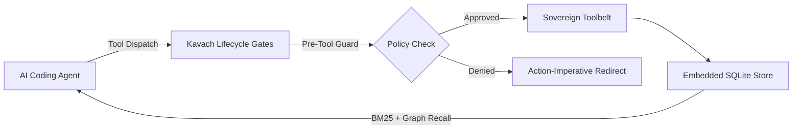

# Kavach

A sovereign in-process Rust harness and cognitive memory bank for autonomous AI coding agents.

[](https://github.com/Gaurav-Wankhede/kavach-rs/releases/latest)
[](LICENSE)
[](https://www.rust-lang.org)
[](https://doc.rust-lang.org/edition-guide/)

---

<div align="center">
  <a href="https://raw.githubusercontent.com/Gaurav-Wankhede/kavach-rs/main/docs/assets/kavach-demo.mp4">
    <strong>▶ Watch Kavach Demo (MP4)</strong>
  </a>
  <br>
  <sub>Video: <code>docs/assets/kavach-demo.mp4</code></sub>
</div>

---

## What is Kavach?

Kavach is an open-source, sovereign in-process development harness for autonomous AI coding agents (Claude Code, Cursor, Codex). Built entirely in Rust 2024, Kavach wraps agent execution inside deterministic lifecycle gates, prevents token context bloat via AST-aware CLI proxies, and preserves engineering decisions across sessions using an embedded SQLite memory store.

---

## Why Kavach?

| Without Kavach | With Kavach |
| :--- | :--- |
| **Stateless Amnesia**: Re-researches solved problems every session | **Persistent Memory**: Decisions and architecture persist in embedded SQLite |
| **Context Window Rot**: Dumps 5,000-line files via cat/grep, exhausting tokens | **Sovereign Toolbelt**: Zero-read AST slices via Tree-Sitter (`kavach grep --def`) |
| **Hallucinated Pipelines**: Emits complex shell pipes (`|`) that fail unpredictably | **Pure In-Process Execution**: Zero pipes, structured TOON output format |
| **Destructive Surprises**: Executes unconstrained `rm -rf` or unvetted scripts | **Deterministic Gates**: Pre-tool interception blocks hazardous commands |
| **Premature Surrender**: Reports "BLOCKED" on compiler warnings or test errors | **Action-Imperative Redirects**: Denials supply exact next-action commands |

---

## Instant Installation

Install the release binary and provision the sovereign toolbelt with a single command:

```bash
curl -fsSL https://raw.githubusercontent.com/Gaurav-Wankhede/kavach-rs/main/install.sh | bash
```

The installer automatically:
1. Bootstraps the pinned Rust toolchain (Edition 2024).
2. Builds the optimized `kavach` binary into `~/.local/bin`.
3. Provisions the sovereign CLI proxies (`grep`, `glob`, `json`, `replace`, `script`, `cargo`).
4. Merges deterministic hook definitions into your active AI coding agent harnesses.

---

## Agent Harness Integration Matrix

Kavach integrates into all major AI coding agents via native lifecycle hooks:

| Harness | Configuration File | Hook Target |
| :--- | :--- | :--- |
| **Claude Code** | `~/.claude/settings.json` | Merges pre-tool, post-tool, and stop-gate hooks |
| **Cursor** | `~/.cursor/hooks.json` | Injects rules and mistake ledger on prompt submit |
| **Codex** | `~/.codex/config.toml` | Connects to SessionStart and UserPromptSubmit |
| **OpenCode** | `~/.config/opencode/hooks.json` | Standard JSON-RPC event bus dispatch |

---

## Sovereign Toolbelt

Kavach replaces legacy, context-polluting POSIX utilities with in-process, AST-aware equivalents:

```
kavach
├── grep         Polyglot AST pattern search across 28 languages (replaces ripgrep/sg)
├── glob         Zero-heap, gitignore-aware path locator (replaces find/fd)
├── trace        AST symbol definition, caller graph, and blast radius (replaces manual greps)
├── json         Zero-bloat dot-path projection emitting TOON tabular output (replaces jq/jaq)
├── replace      Atomic multi-pattern in-place replacement via Aho-Corasick (replaces sed/sd)
├── cargo        Context-defending cargo proxy; routes to nextest and silences compiler spam
├── script       In-memory Rhai pseudo-code engine with live HTTP, sitemap, and llms.txt discovery
└── git          Zero-bloat in-process Git suite powered by 100% pure-Rust gix
```

---

## Cognitive Memory Bank

Kavach maintains a local, embedded database holding structured engineering knowledge across sessions:

- **Decisions**: Architectural and design choices that are never re-litigated.
- **Mistakes**: Anti-pattern ledger clustering historical mistakes to prevent repeat regressions.
- **Roadmap**: Dependency-aware task cards and execution status.
- **Hybrid Retrieval (`kavach think`)**: BM25 keyword matching fused with graph traversal via Reciprocal Rank Fusion (`k=60`). Returns citable keys in under 2ms.

---

## Architecture



---

## Frequently Asked Questions

### What makes Kavach different from shell hooks?
Shell hooks execute shell scripts with fragile text piping and high subshell overhead. Kavach is a unified, compiled Rust binary running in-process with sub-millisecond evaluation latency, AST parsing via Tree-Sitter, and zero dependencies on external database daemons.

### How does Kavach prevent LLM context bloat?
Legacy tools like `cat` dump entire files into the agent conversation, consuming tens of thousands of tokens. Kavach blocks whole-file reads and provides surgical slice extraction (`kavach grep --def <symbol>`, `kavach slice <file> <range>`), keeping LLM context clean and focused.

### Does Kavach require an active internet connection?
No. The core memory bank, AST engines, git suite, and gate policies run 100% offline and local on your machine.

---

## License

MIT License. Copyright (c) 2026 Wankhede Brothers.
---

## Recommended Agent Prompt Templates (`prompts/`)

For autonomous AI coding agents (Antigravity, Claude Code, Cursor, Codex), canonical SSOT prompt templates are provided in [`prompts/`](prompts/):
- **`AGENTS.md`** / **`CLAUDE.md`** / **`SOUL.md`**: Lean Action Imperative Router (Zero law text, pure pointers).
- **`AGENTS.json`**: Machine-Executable Single Source of Truth schema containing universal imperatives, toolbelt mappings, and domain sovereignty laws.
